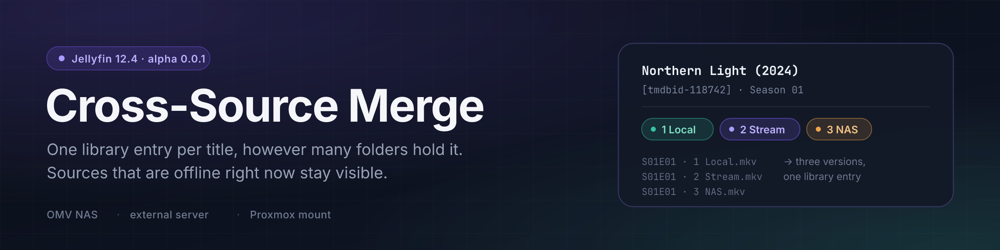
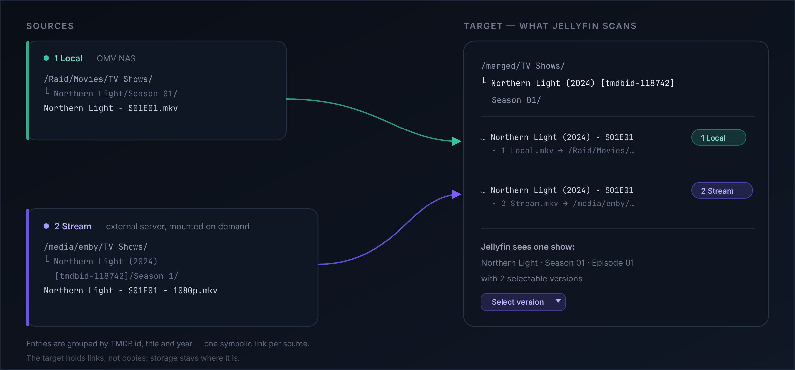
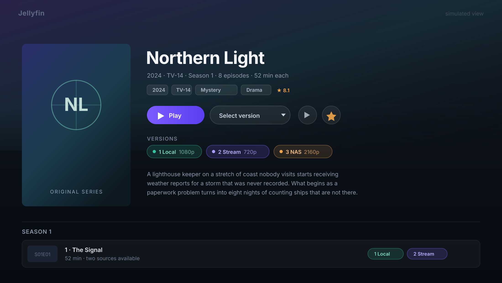
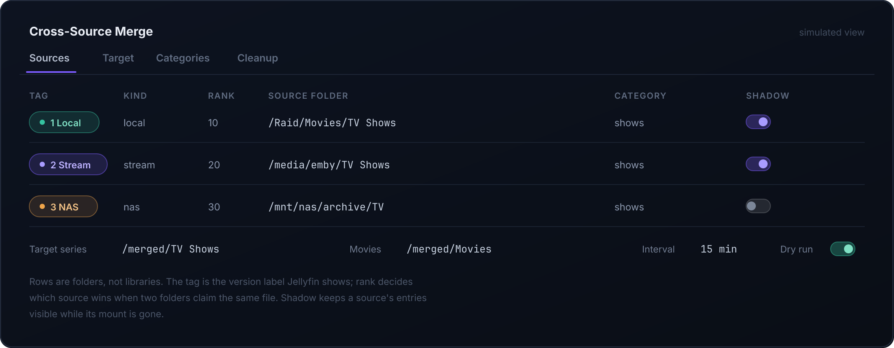
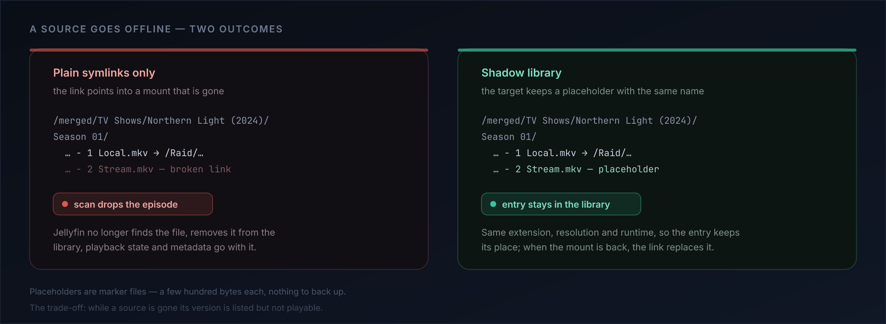

# Cross-Source Merge for Jellyfin

[](https://github.com/HaesslicherBob/jellyfin-cross-source-merge/actions/workflows/build.yml)
[](https://github.com/HaesslicherBob/jellyfin-cross-source-merge/releases)
[](https://jellyfin.org)
[](LICENSE)



A Jellyfin plugin that merges movies and series from several source folders into
**one** target tree — as symbolic links, never as copies. Jellyfin then sees a
single library holding every version, whether the file sits on a NAS, on a local
disk or is only a stream link.

The plugin is self-contained: no Python, no helper script, no extra file to keep
in sync. The only thing to configure is **directories**.

> **Alpha.** Version 0.0.1 is the first public release and a first draft: the
> core works — it runs daily on a production server — but the API, the
> configuration file and the settings page may still change. Read the notes at the
> end before pointing it at a library you care about.

## What it does

- reads the source folders and groups them by TMDB id, title and year
- creates one folder per title in the target, holding one file per source
  - `Northern Light (2024) [tmdbid-118742]/Northern Light (2024) [tmdbid-118742] - 1 Local.mkv`
  - `... - 2 Stream.strm`, `... - 3 NAS.mkv` — Jellyfin offers the versions for selection
- for series: `<Title>/Season 01/<Title> - S01E01 - 1 Local.mkv`
- when a source is missing (NAS off) the existing links stay in place —
  nothing is deleted
- runs as the task **Cross-Source Merge** under *Dashboard > Scheduled Tasks*,
  on demand, on its own schedule or at server startup

Nothing happens without you: the task has no schedule, and the first setting is
**dry run** (it only calculates and logs).



Two folders, two naming schemes, one entry. The target holds links — the files
stay exactly where they are, and the source can keep its own layout.

## What it looks like in Jellyfin



The source tag is the version label. **1 Local**, **2 Stream** and **3 NAS** are
the same episode; the metadata, watched state and artwork belong to the entry,
not to the file.

## Installation

**Through the plugin repository** (the normal way):

1. *Dashboard > Plugins > Catalog* (or *Repositories*) -> *Add*
2. Name `Cross-Source Merge`, URL
   `https://raw.githubusercontent.com/HaesslicherBob/jellyfin-cross-source-merge/main/manifest.json`
3. *Catalog* -> *Cross-Source Merge* -> *Install*
4. restart Jellyfin

**By hand** (if you do not want a repository): unpack the release ZIP into
`<jellyfin-data>/plugins/Cross-Source Merge_<jellyfin-version>/` (the folder name
must be one Jellyfin can parse; an existing `Cross-Source Merge_0.0.1` folder is
fine) and restart.

## Setup

*Dashboard > Plugins > Cross-Source Merge*. The page has:

| Field | Meaning |
|---|---|
| Target folder movies | where the movie library is built |
| Target folder series | where the series library is built |
| Sources | one name, one kind and the source folder per row |
| Dry run | on = calculate and log only, write nothing |
| Run at startup | merge automatically when the server starts |

The **kind** of a source decides how its files are treated:

| Kind | Meaning |
|---|---|
| `local` | files on a disk, always available |
| `nas` | network share: can fail; `.strm` files inside it only count as a fallback |
| `stream` | only `.strm` links to URLs; real copies there are ignored |

A row of the source table is **one folder**. Movies and series of the same
device are two rows — only that way can each folder keep its own rank and its
own tag. Every row has:

| Field | Meaning |
|---|---|
| Tag | name in the file name (`1 Local`, `2 Stream`); must be unique |
| Rank | number, lower wins; **every rank only once**; never appears in a file name |
| Source folder | the folder that is read |
| Default category | target category for new entries from this folder |
| Shadow | entries stay in place while the folder is missing |

The **rank** decides which medium wins when sources disagree (lower = closer to
the original): the title of the best medium names the folder, and the rank sorts
sources in the plan and in the lists. It does not appear in file names — the tag
distinguishes sources there.

Afterwards point two Jellyfin libraries at the two target folders (movies and
series). A library scan is not triggered by the plugin.

### Settings that still carry two folders in one row

A configuration can hold rows with two folders in one entry (`MoviesPath`,
`SeriesPath`). On start such a row is split in memory: the movie folder keeps tag
and rank, the series folder gets `<Tag> Series` and a rank above the highest so
far, and both are stored with the next save of the settings page. Because the
naming rule builds the target name from a single folder, renamed targets appear
after the first run; files created under the old name stay where they are. Empty
the target folders once and merge again, or use the *Cleanup* tab.

## Naming rule

The target name is always `Title (Year) [tmdbid-123]`; for movies the file name is
`<target name> - <tag> <number>.<ext>`, for episodes
`<target name> - S01E10 - <tag>.<ext>`.

Jellyfin then lists exactly this in one movie entry:

```
Toy Story 5 (2026) [tmdbid-1084244]/   -> versions: 1 Local, 2 Stream 1,
  ... - 1 Local.mkv                                 2 Stream 2, 2 Stream 3,
  ... - 2 Stream 1.strm                             3 NAS 1, 3 NAS 2
  ... - 3 NAS 1.mkv
```

- The `<number>` sits **behind the title** and counts the files the **same
  source** contributes to this title (different qualities). It is dropped when
  the source has only one version: `- 2 Stream.strm` instead of `- 2 Stream 1.strm`.
  Jellyfin reads the text after the last ` - ` as the version name; the tag
  stays untouched (`- 3 NAS 2`, not `- 3 NAS2`).
- **No extra ` - `** before the number: Jellyfin splits at the *last* ` - `, so
  `... - 3 NAS - 1` would turn the source into a separate movie.
- The **rank** is in no file name, not even for episodes: sources are told apart
  by the tag (`1 Local`, `2 Stream`, `3 NAS`), and there is exactly one file per
  episode, so there is nothing to count there.
- If a source folder holds several video files (two qualities, two streams of
  the same provider) they are all taken over as versions: the largest is number
  1, on a tie the path decides — that keeps the number stable between two runs.
  Extras (`-trailer`, `-sample`, `-featurette`, ...) do not count.
- Title and year come from the Jellyfin library (the `[tmdbid-…]` tag is supplied
  by Jellyfin itself). Without an id the previous folder name stays — an
  imperfect name is better than a wrong one.
- Extra tags in a name (resolution, source, language, codec) and doubled years
  or separators are reduced to the same comparison key, so the same title from two
  sources finds itself (`Nordlicht.1994.1080p.German` -> `nordlicht 1994`).
- Articles and numbers in a title are kept (`The Matrix` stays `The Matrix`,
  `Blade Runner 2049` stays `Blade Runner 2049`).
- A name is never appended twice: if the previous folder name already ends in a
  year or an id, that part is cut off before the name is put together.

### The year trap with four-digit ids

Jellyfin reads every four-digit number between 1900 and 2099 in a folder name as
a release year — whether or not it is in brackets. Titles with a four-digit TMDB
id (*Training Day* `2034`, *Ratatouille* `2062`, *The Amazing Spider-Man* `1930`)
therefore had the year twice in the name, and Jellyfin took the **id** as the
year: `Training Day (2001) [tmdbid-2034]` became `ProductionYear 2034`, in the
library and in the NFO.

For exactly those ids (1900–2099) the plugin swaps the order:
`Title [tmdbid-2034] (2001)`. The first four-digit number is then the year. Ids
from 10000 up and below 1900 keep the old form, there is no mix-up there.

Existing NFO files with the wrong year are corrected by `CorrectNfoYear` (switch
on the settings page): if the `<year>` field holds exactly the id, the year from
the folder name is written; otherwise the NFO is left alone.

## Build

```
dotnet build src/Jellyfin.Plugin.CrossSourceMerge/Jellyfin.Plugin.CrossSourceMerge.csproj -c Release
```

Rules and a run against real folders:

```
dotnet run --project tests/laufprobe -c Release -- /path/source1 /path/source2
```

What differs on other systems (links, path comparison, ffmpeg lookup, file names,
language):

```
dotnet run --project tests/laufprobe -c Release -- --fremdsystem
```

The finished DLL lands in
`src/Jellyfin.Plugin.CrossSourceMerge/bin/Release/net10.0/`.

## On another machine

The plugin does not rely on the machine it was written on. What it does assume is
listed here — the rest is looked up:

- **Jellyfin 12.4 or newer.** Built against `Jellyfin.Controller 12.4.0`
  (`net10.0`, `targetAbi 12.4.0.0`). On a server with an older Jellyfin the DLL
  does not load — use the plugin version that matches.
- **ffmpeg.** Looked up, not required: first the configured path, then the build
  that ships next to the Jellyfin server, then `PATH`, then the usual places
  (`/usr/lib/jellyfin-ffmpeg`, `/usr/bin`, `/opt/homebrew/bin`,
  `C:\Program Files\Jellyfin\Server`). On Windows `ffmpeg.exe` is searched. If it
  is missing the merge continues without placeholders — the report then says that
  none were created.
- **Links.** The target folder must accept symbolic links. On Windows the Jellyfin
  service needs developer mode or administrator rights for that; an SMB/NTFS
  share often cannot do it at all. This is checked before the first write, with a
  plain-language message instead of tens of thousands of error lines.
- **Case sensitivity.** Windows, macOS and SMB shares ignore case. The plugin
  measures this on the target folder, compares paths accordingly (otherwise every
  link would be recreated on every run) and warns when two titles differ only in
  spelling.
- **Name rules.** On Windows characters the system forbids are replaced:
  `Dune: Part Two` becomes `Dune - Part Two`, a trailing dot and space are
  dropped, device names such as `CON` or `COM1` get an underscore. On Linux and
  macOS the name stays as it is. A tree built on Linux therefore cannot simply be
  moved to a Windows machine — the folders are created anew there.
- **Language.** With *Search language* empty the server language applies
  (`PreferredMetadataLanguage` in `system.xml`). A value of your own overrides it.
- **Kill foreign processes** is off by default and only works on Linux (it reads
  `/proc`). It is a cleanup aid for the move away from an old Python run, not
  required behaviour.

## Limits

- The plugin runs inside the Jellyfin process, so as the service user (usually
  `jellyfin`). That user needs read access to the sources and write access to the
  target. Links need no special rights, but the target tree must not live on a
  file system that cannot do symbolic links (an SMB share from Windows, for
  instance).
- A source that cannot be reached is skipped; existing links stay.
- Only links are created. Nothing is renamed, nothing is deleted.

## Licence

GPL-3.0-only, like Jellyfin itself.

## Categories

A category is its own library in the target tree, not a label on a title:
`Documentaries` and `TV Shows` sit next to `Movies` and `Series` because they fit
neither. A title may live in several categories; every category has a target
folder and optionally a pattern (part of the source folder).

Whether episodes live there is said by the category itself (switch *Episodes*:
`S01E01`). So there is no second axis "kind" next to the category — the switch is
a property of the category, nothing more. Exactly one category per that property
is *standard*, for titles without a mapping of their own.

## Schedule, manual start, status

`IntervalMinutes` (settings, 0 = off) lets the plugin run on its own interval — a
systemd timer is not needed. The **Run now** button starts immediately; next to it
is the state of the last pass, green or red.

Red means: the pass did not finish, was aborted, had errors, or the interval is
shorter than the runtime ("cycle too short"). The status lives in
`crosssource-status.json` next to the state file.

### A separate cycle for the source check

`CheckIntervalMinutes` (default 5, 0 = off) is independent of `IntervalMinutes`:
that often the plugin only asks whether the source folders are still there. When
the answer changes it is noted in the log — and when a source comes back the
merge runs **immediately** instead of waiting for the next big interval. That is
the point where a shadow copy becomes current again: NAS briefly gone, a run
missed, NAS back, a few minutes later the entries are in the target tree again.

```
[INF] Cross-Source Merge: source check every 5 minutes
[WRN] Cross-Source Merge: not reachable - "/media/nas-movies/Movies"
[INF] Cross-Source Merge: reachable again - "/media/nas-movies/Movies"
```

A run that shows as "running" for more than 90 minutes counts as stuck and no
longer blocks the trigger. If the server dies during a run, the next start
releases the status (entry *aborted*) — otherwise the scheduler would be blocked
for 90 minutes.

At startup and before every writing run the plugin terminates foreign merge
processes (`merge_sync.py`, `merge_guard.py`) so that only one program writes into
the target tree. Two writers with their own ordering otherwise rename each
other's folders: measured, that was 38,632 newly created entries in one run after
two hours.

## Backups

Before every writing run the plugin copies the state file to
`backups/<time>-state.json` (count via `BackupsToKeep`, default 20). The settings
page shows the list, the size and **restore**; the previous version stays as
`crosssource-state.json.before-restore`. The state is what gets backed up because
it is the only thing a run cannot rebuild: chosen names, manual mappings,
categories.

## The settings page

The page has five tabs:

| Tab | Content |
|---|---|
| Overview | state of the last run, numbers, *Run now*, backups (list, size, *restore*) |
| Mappings | one row per source folder that has no id, filterable, sortable, paged |
| Sources & Categories | one row per folder with rank, tag, default category |
| Cleanup | targets without a source: folders and files the plan no longer knows — remove them one by one or all at once |
| Settings | target folders, schedule, source check, dry run, NFO, cleanup, keys |



One row per source folder: the tag becomes the version label, the rank decides
which source wins, the shadow switch keeps that source's entries visible while
its mount is gone.

### Categories (documentaries, TV shows, events)

The category is the library, not the kind. Create it in the *Sources &
Categories* tab, section **Target folders (categories)**: name, target folder and —
if episodes live there — the *Episodes* checkbox. Exactly one category per kind is
*standard*; everything without a mapping of its own goes there.

Filing is done in the *Mappings* tab: every row has a **Category** column with the
categories of the selected kind. A choice is saved at once (`POST /Kategorie`);
*Standard* takes the title's own mapping back. A title then lives **only** in that
category — marking a movie as a documentary takes it out of *Movies* instead of
duplicating it. Via `Kategorien: ["Movies", "Documentaries"]` at the same place a
title can deliberately be put into two trees.

Filtering uses the selection on the left of the bar (*all categories*, *without
own category*, then the names) — that way you can check what is already marked as
a documentary, and after the next run verify that only what belongs there is in
the target tree.

The mapping hangs on the title (its id) and additionally on the source folder: if
a title later moves to another source, the folder entry still applies.

### Mappings

The list shows every source folder for which no id is found — one row per source,
because the same movie can come from three sources with three ids. On top are the
search field, the kind (movies/series), the state (all/open) and the number of
rows per page; the column headers sort.

Per row:

- **Provider**: TMDB, IMDB, TVDB or OMDB — the choice applies to this row only
- **Id**: `603`, `tt0133093`, `81189` or an OMDB id
- **Search title** fills id, name and year from the folder name (TMDB)
- **Load info** fetches title and release year from the chosen provider
- **Name** and **Year** are editable afterwards, the *Target* column shows at once
  what the folder will be called
- **Apply** stores the mapping, **Delete** takes it back

Folders without their own medium are not in the list: a `.strm` in a NAS source is
a stream link, not a file on the NAS, and only counts as a fallback there (as in
the merge). The number of such folders is shown behind the page indicator.

Titles the library knows unambiguously by name and year count as mapped and are
not in the list — they get their *library* mark. If a source stays without an id,
the target name is the folder name, so that nothing is named wrongly.

**Merge** starts a run after the mapping, without changing the tab.

IMDB (`tt…`) and TVDB (number) are resolved through TMDB `/find`; the target
folder then carries the TMDB id. OMDB delivers title, year and IMDB id via
`omdbapi.com` and needs its own key (*OMDB key* field in the *Settings* tab).

## Manual ids

Titles that were recognised wrongly can be corrected: enter source folder (name or
full path), provider (TMDB, IMDB, TVDB) and id, *Check* confirms title and year at
TMDB, *Save* stores the mapping in the state (`Zuordnungen`, keyed by the source
folder).

IMDB (`tt0111161`) and TVDB (number) are resolved through TMDB `/find` first; the
target folder then carries the TMDB id, because Jellyfin understands it without an
extra plugin.

If TMDB has **no** counterpart (small documentaries, regional releases), the plugin
asks the TVDB provider of your own Jellyfin instance for provider TVDB — title and
year come straight from there, no separate key needed. What is stored then is
`tvdb:407966`, the target folder is called `Title (Year) [tvdbid-407966]`, and
`tvshow.nfo`/`movie.nfo` carries `<tvdbid>` so Jellyfin binds the title through
TVDB.

Without a TMDB key in the *Identification* field nothing can be checked — a plain
TMDB number is then stored unchecked and the page says so.

Endpoints (admin token required):

```
GET    /Plugins/CrossSourceMerge/Bestand?art=&status=&kategorie=&suche=&sort=&richtung=&seite=&groesse=&erneuern=
GET    /Plugins/CrossSourceMerge/Kennung?anbieter=&kennung=&serie=
GET    /Plugins/CrossSourceMerge/Kennung/Suche?name=&jahr=&serie=
GET    /Plugins/CrossSourceMerge/Zuordnungen
POST   /Plugins/CrossSourceMerge/Zuordnung      {Ordner, Anbieter, Kennung, Serie, Name, Jahr}
DELETE /Plugins/CrossSourceMerge/Zuordnung?ordner=
POST   /Plugins/CrossSourceMerge/Kategorie      {Ordner, Quelle, Schluessel, Serie, Kategorien[]}
GET    /Plugins/CrossSourceMerge/Status
POST   /Plugins/CrossSourceMerge/Lauf
GET    /Plugins/CrossSourceMerge/Sicherungen
POST   /Plugins/CrossSourceMerge/Sicherung
POST   /Plugins/CrossSourceMerge/Sicherung/Zurueck   {Name}
```

`Bestand` returns `kategorien` (current mapping per row) and, at the top of the
answer, `kategorien` (all categories of the kind) as well as `standardKategorie`
(the standard category). `kategorie=standard` means "without own category".
`Kategorie` with an empty list resets to the standard; unknown names are rejected
with 400.

The route and field names are German — an API cleanup is planned for a later
alpha, renaming them now would break the page and any script on your side.

## Shadow library



When a source cannot be reached (NAS off, mount gone) every existing entry stays:
the link is neither checked nor deleted, and the dead mount is not touched.

A title that was never there gets a placeholder: black picture and silent audio,
but with **the same extension, resolution and runtime as the original** (values
from `crosssource-state.json`, default 1080p/90 minutes). That is the point:
Jellyfin has to recognise the same entry again. A `.strm` or a short clip in that
place changes the file, Jellyfin drops the entry and rescans the library — exactly
what the shadow library is meant to prevent.

## Metadata

If a title folder has no NFO, the plugin writes `movie.nfo` or `tvshow.nfo` with
title, year and TMDB id (switch in the settings). Existing NFO files are left
alone — they hold images, plot and cast that Jellyfin maintained itself.

Title and year of a title come from the manual mapping, else from the Jellyfin
index, else from the folder name. The chosen display name is kept in the state so
that a folder is not renamed between two runs.

## Tag: unique per media kind

The tag appears in the file name (`... - 3 NAS.mkv`) and is shown by Jellyfin as
the version. It may be the same for movies and series — the trees are separate, so
both are called "3 NAS" instead of one being "3 NAS Series".

Within one media kind it has to stay unique: the plan matches contributions per
title by tag, two movie sources with the same tag would plan the same file twice
and never map the second source's file — and because the shadow copy then looks
"present" it is never fetched. The default category of the second source is lost
as well.

The settings page rejects this on save. Because the API does not, and the XML file
can be edited by hand, the run aborts on its own as well:
`Id assigned more than once: ...` as an error in the status, nothing is backed up
and nothing is written. A source without a default category counts for both kinds
and therefore collides with both.

## Cleanup

The merge writes and renames, it never deletes. When the naming rule changes or a
source disappears for good, targets stay that no source feeds any more: a folder
without a title, a file under an old name.

Every run records what it created — `crosssource-soll.json` next to the state file,
per target folder the folder names it carries and the files it planned. The
**Cleanup** tab compares the target tree against that, without reading the sources
again: it takes seconds and does not wake a NAS.

| Column | Meaning |
|---|---|
| Kind | `Folder` (no title any more) or `File` (not in the plan) |
| Name | as in the target tree, full path as a tooltip |
| Category | target folder the entry sits in |
| Files / Size | counted for folders, empty otherwise |
| Changed | last modification, so you can see how old the leftovers are |

Tick entries and **Remove selected**, or **Remove all**. Entries are moved to
`<target>-alt/aufraeumen/<date>/<relative path>`, nothing is deleted — putting them
back is one `mv`. The number on the tab shows how much is lying around.

Companion files stay as long as they belong to a planned file: `movie.nfo`,
`tvshow.nfo`, `poster.jpg` and relatives describe the folder, not a single file. A
`... - S01E01 - 2 Stream.nfo` whose medium is gone, on the other hand, counts as
orphaned. Without that rule 4,894 metadata files would have been in the list.

Two brakes are built in. If a source is missing during a run, nothing is removed
and the expected list stays the old one — otherwise every NAS that briefly
disappears would mark its titles as orphaned. And what an aborted run half
created shows up in the list afterwards: that is exactly what it is for.

Automatic cleanup is available too: in the settings, section *Cleanup*, there is
`CleanupDays` (default 30). Only when *clean up orphaned folders* is on does a run
remove by itself — and only what is older than the configured number of days.
Fresh leftovers therefore survive a brief NAS outage.

## Taking over an existing state

`crosssource-state.json` sits next to the plugin configuration and holds manual
mappings (source folder to TMDB id), aliases and the remembered image data. The
file can be taken over from an earlier solution; it is plain JSON.

## Notes for the alpha

- The API and the configuration file still use German field and route names
  (`Kennung`, `Zielpfad`, `Quelle`, ...). They are not user-visible in Jellyfin but
  they show up in scripts and in the XML file. Renaming them is a breaking change
  and is planned for a later release together with a migration step.
- Built and exercised on Linux (Proxmox, .NET 10, Jellyfin 12.4). Windows and
  macOS code paths exist and are covered by unit tests, but are not field-tested
  by the author.
- The images in `docs/` are rendered mockups with invented titles, not photos of a
  running library — see [docs/README.md](docs/README.md) for the sources.
- Bug reports are welcome; please include the log lines mentioning
  `Cross-Source Merge` and your Jellyfin version.
